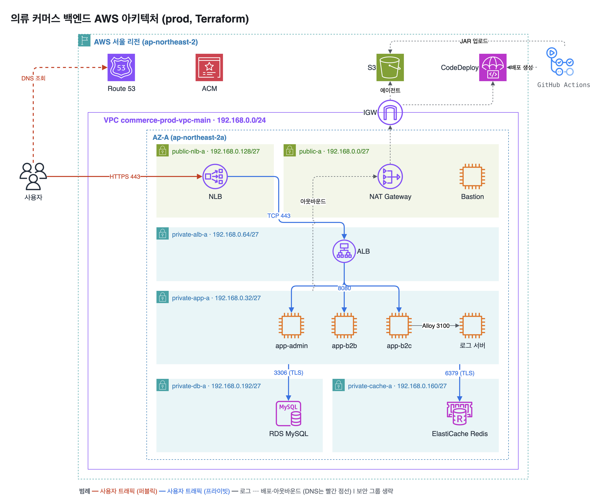

# commerce-infra-claude

Spring Boot 기반 의류 커머스 백엔드(admin, b2b, b2c)를 위한 AWS 인프라를 Terraform으로 구성한 프로젝트입니다.

- 기능과 인프라 동작을 검증하는 **개인 MVP용 단기 인프라**입니다. 
- 대규모 트래픽 확장과 운영 고도화는 범위에서 제외했습니다.
- dev, staging 없이 **prod 단일 환경**만 구성합니다.
- 비용 상한은 **월 100달러(VAT 포함)** 이며, 테스트가 끝나면 리소스를 삭제합니다.
- 상세 요구사항, 설계, 결정 근거는 [`docs/`](docs/)의 기준 문서를 참고하세요.


## 1. 아키텍처



```
Users → NLB (EIP, TCP 443) → ALB (internal, TLS 종료, Host 기반 라우팅) → EC2 (admin / b2b / b2c, :8080)
```

- 인터넷에 노출되는 진입점은 **NLB 하나**입니다. 고정 공인 IP(EIP 1개)를 주기 위해 NLB를 두고, TLS 종료와 호스트별 라우팅은 내부용 ALB가 맡습니다.
- 앱 서버는 RDS for MySQL과 ElastiCache Redis에 TLS로 접속합니다.
- 각 앱 서버의 Grafana Alloy가 로그 서버(Loki, Grafana)로 로그를 보냅니다.
- 프라이빗 서브넷의 아웃바운드는 NAT Gateway를 거쳐 IGW로 나갑니다. CodeDeploy 에이전트도 이 경로로 S3와 CodeDeploy에 접근합니다.
- 관리자는 Bastion을 경유해서만 내부 리소스에 접근합니다.
- 인스턴스는 모두 AZ-A(ap-northeast-2a)에 둡니다.
- 상세 설계와 선택 근거: [`docs/03-architecture.md`](docs/03-architecture.md), [`docs/04-design/`](docs/04-design/), [`docs/adr/`](docs/adr/)


## 2. 문서 구성과 작업 방식

| 문서 | 역할 |
|---|---|
| [`docs/discovery/questions.md`](docs/discovery/questions.md) | 요구사항을 모으기 위한 질문과 답변 |
| [`docs/00-context.md`](docs/00-context.md) | 배경, 제약 조건, 가정, Open Questions |
| [`docs/01-requirements.md`](docs/01-requirements.md) | 기능·비기능 요구사항(FR, NFR)과 검증 방법 |
| [`docs/02-options.md`](docs/02-options.md) | 설계 결정 지점별 대안 비교 |
| [`docs/adr/`](docs/adr/) | 아키텍처 결정 기록 (ADR-001 ~ ADR-014) |
| [`docs/03-architecture.md`](docs/03-architecture.md) | 확정 아키텍처, 주요 흐름, 요구사항 충족 표 |
| [`docs/04-design/`](docs/04-design/) | 상세 설계 (network, security, compute, data) |
| [`docs/05-implementation-plan.md`](docs/05-implementation-plan.md) | Terraform 구현 단계, 검증 항목, 위험, AI 작업 규칙 |
| [`docs/reviews/`](docs/reviews/) | AI 독립 리뷰 결과 (요구사항, 아키텍처, 보안·안정성·구현 가능성) |
| [`ai-log/ai-decisions.md`](ai-log/ai-decisions.md) | AI 리뷰·제안에 대한 엔지니어 결정 이력 |
| [`terraform/README.md`](terraform/README.md) | 실행 방법, 변수, Terraform 밖 작업 목록, 단계별 검증 기록 |

### 작업 흐름
이 프로젝트는 **엔지니어가 요구사항과 최종 결정을 맡고, AI(Claude Code)가 문서 작성, 리뷰, 구현을 지원**하는 방식으로 진행했습니다. 작업 규칙은 [CLAUDE.md](CLAUDE.md)에 정의되어 있습니다.

1. **요구사항 수집**: 질문지([`discovery/questions.md`](docs/discovery/questions.md))에 엔지니어가 답하고, 그 답을 00-context로 정리했습니다. 정보가 부족한 항목은 Open Questions(Q-01 ~ Q-37)로 등록해 하나씩 결정했습니다.
2. **요구사항 정의와 리뷰**: 01-requirements를 작성하고 AI 독립 리뷰([`01-requirements-review`](docs/reviews/01-requirements-review.md), R-01 ~ R-29)를 거쳤습니다.
3. **대안 비교**: 결정 지점마다 대안을 2개 이상 비교하고(02-options), 엔지니어가 고른 결과를 ADR로 남겼습니다.
4. **아키텍처와 리뷰**: 03-architecture를 작성하고 AI 독립 리뷰([`03-architecture-review`](docs/reviews/03-architecture-review.md))를 거쳤습니다.
5. **상세 설계와 3관점 리뷰**: 04-design을 작성한 뒤 보안(SEC 14건), 안정성(REL 12건), 구현 가능성·비용(COST 22건) 관점의 리뷰를 각각 받았습니다. 겹치는 지적을 DR-01 ~ DR-35로 합치고([`design-review-summary`](docs/reviews/design-review-summary.md)), 항목마다 엔지니어가 채택, 수정, 기각 중 하나로 결정했습니다.
6. **구현 계획 승인**: 05-implementation-plan이 승인된 뒤에만 Terraform 코드를 작성했습니다.
7. **Terraform 구현**: 모듈 단위 8단계로 나눠 `fmt`·`validate` → `plan` 검토 → 엔지니어 승인 → `apply` → 설계 문서의 검증 항목 확인 순서로 진행했습니다. 결과는 [`terraform/README.md`](terraform/README.md) 4절에 기록했습니다.

원칙은 다음과 같습니다.
- 앞 문서가 Approved 상태가 아니면 다음 문서를 작성하지 않습니다(00 → 05 순서).
- 정보가 부족하면 추측하지 않고 Open Questions에 추가한 뒤 질문합니다.
- AI의 제안은 승인된 결정이 아닙니다. 결정은 엔지니어가 내리고 [`ai-decisions.md`](ai-log/ai-decisions.md)에 원문 그대로 기록합니다.
- 모든 설계 항목에 관련 요구사항 ID를 표기합니다.
- AI는 `terraform apply`·`destroy`를 직접 실행하지 않습니다(05 AI-01).

## 3. 기술 스택과 버전

| 항목 | 값 |
|---|---|
| Terraform | 1.17.2 |
| AWS Provider | hashicorp/aws 6.71.0 |
| Region | ap-northeast-2 (서울) |
| State | Local State (`terraform/terraform.tfstate`, Git 제외) |
| 애플리케이션 | Java 17, Spring Boot 3.4.0, Ubuntu 24.04 LTS, JAR 실행 |
| 컴퓨팅 | EC2 온디맨드 — 앱 서버 3대·Bastion t3.medium, 로그 서버 t3.large |
| 데이터 | RDS for MySQL 8.4 (db.t3.micro, Single-AZ), ElastiCache Redis OSS 7.1 (cache.t3.micro, 노드 1개) |
| 로그 | Grafana Alloy, Grafana Loki, Grafana (자체 호스팅) |
| CI/CD | GitHub Actions, S3, CodeDeploy |
| DNS·인증서 | Route 53, ACM (`*.imcommerce.shop`) |


## 4. 디렉터리 구조

```
.
├── CLAUDE.md                 # 프로젝트 작업 규칙 (설계 단계 규칙)
├── README.md
├── .gitignore                
├── ai-log/
│   └── ai-decisions.md       # AI 리뷰·제안에 대한 엔지니어 결정 이력
├── docs/                     # 요구사항, 대안 비교, 아키텍처, 설계, 구현 계획
│   ├── discovery/
│   ├── adr/
│   ├── 04-design/
│   └── reviews/
├── images/                   # 아키텍처 다이어그램
└── terraform/
    ├── README.md             # 실행 방법, 변수, Terraform 밖 작업 목록, 검증 기록
    ├── versions.tf           
    ├── providers.tf          
    ├── variables.tf          
    ├── terraform.tfvars.example
    ├── main.tf               
    ├── outputs.tf            
    └── modules/
        ├── network/          # VPC, Subnet, IGW, NAT Gateway, Route Table
        ├── security/         # Security Group 7개와 ingress·egress 규칙
        ├── dns_cert/         # Route 53 Public Hosted Zone, ACM 인증서
        ├── compute/          # EC2 5대 (앱 3, 로그, Bastion), IMDSv2, 루트 볼륨 암호화
        ├── data/             # RDS for MySQL, ElastiCache Redis와 각 Subnet Group
        ├── edge/             # NLB, EIP, internal ALB, Target Group, Listener, 호스트 규칙
        └── deploy/           # 배포 아티팩트 S3 Bucket, CodeDeploy Application
```


## 5. 관리 범위

### Terraform이 생성하는 리소스 (81개)
| 구분 | 리소스 |
|---|---|
| Network | VPC, Subnet 8, IGW, NAT Gateway, EIP 1, Route Table 2와 연결 8 |
| Security | Security Group 7, ingress 규칙 12, egress 규칙 7 |
| DNS·Certificate | Route 53 Public Hosted Zone, ACM 인증서 |
| Compute | EC2 5대 (admin, b2b, b2c, log, bastion) |
| Data | RDS for MySQL과 Subnet Group·Parameter Group, ElastiCache Redis와 Subnet Group |
| Load Balancing | NLB, EIP 1, NLB Listener, ALB, ALB HTTPS Listener, 호스트 규칙 3, Target Group 4와 등록 4 |
| CI/CD | S3 Bucket(versioning, SSE, Public Access Block), CodeDeploy Application |


## 6. 사용 방법

```bash
aws login                                       # 자격 증명 (루트 액세스 키는 만들지 않음)
cd terraform
cp terraform.tfvars.example terraform.tfvars    # operator_ip_cidr에 운영자 공인 IP(/32) 입력

terraform init
terraform validate
terraform plan -out=tfplan
terraform show tfplan        # 생성·변경·삭제 대상을 검토
terraform apply tfplan       # 검토한 plan 그대로 적용
```

- 호스팅 영역 NS, ACM 검증 레코드, NLB EIP 같은 생성 결과는 `terraform output`으로 확인합니다.
- `terraform apply`와 `terraform destroy`는 엔지니어 승인 후에만 실행합니다.
- `terraform.tfvars`와 State 파일은 Git에 넣지 않습니다.

### 삭제
`destroy` 전에 Terraform이 지우지 못하는 것을 먼저 정리합니다.

1. 아티팩트 버킷의 모든 객체, 이전 버전, 삭제 마커를 지웁니다(`force_destroy = false`).
2. 호스팅 영역에 수동으로 만든 레코드(ACM 검증 CNAME, 서비스 A 레코드)를 지웁니다.
3. CodeDeploy 배포 그룹을 지웁니다.

```bash
terraform plan -destroy -out=destroy.tfplan
terraform apply destroy.tfplan
```

4. `destroy`가 끝나면 IAM 리소스(인스턴스 프로파일, 서비스 역할, GitHub Actions용 사용자와 액세스 키)를 수동으로 지웁니다.

> ⚠️ **destroy하면 데이터를 복구할 수 없습니다.**
> - RDS는 자동 백업 보존 기간이 0이고 최종 스냅샷도 만들지 않습니다(`skip_final_snapshot = true`). 삭제 보호도 꺼져 있습니다.
> - ElastiCache Redis도 스냅샷을 보존하지 않습니다.
