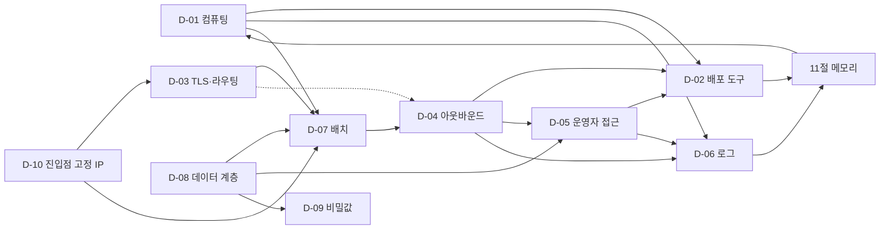

# 02. Options — 의류 커머스(admin/b2b/b2c) 백엔드 AWS 인프라

| 항목 | 값 |
|---|---|
| 상태 | Approved |
| 버전 | 1.4 |
| 날짜 | 2026-11-12 |
| 작성자 | 박가온누리 |
| 선행 문서 | [00-context.md](00-context.md) v1.6 (Approved), [01-requirements.md](01-requirements.md) v1.3 (Approved) |

### 변경 이력

| 버전 | 변경 내용 | 근거 |
|---|---|---|
| 0.1 | 최초 작성. 결정 지점 D-01~D-07 정의, 추가 제안 D-08~D-09 | 00 v1.4, 01 v1.1 |
| 0.2 | D-01~D-09 결정 기록. 각 결정 지점과 15절에 ADR 링크 추가 | 박가온누리 결정 (2026-11-12), [adr/](adr/) |
| 1.0 | 승인. ADR-001~ADR-009는 현재 내용대로 채택 | 박가온누리 승인 (2026-11-12) |
| 1.1 | 00 v1.6·01 v1.3 반영(Q-36). D-04에서 고정 IP 목적을 빼고 "아웃바운드"로 변경. D-10(진입점 고정 공인 IP, NLB + EIP) 추가. 12절 의존 관계, 13절 비용, 15절 결정 요청 갱신. 승인 | 00-context.md v1.6, [ADR-010](adr/ADR-010-inbound-static-ip.md), 박가온누리 승인 (2026-11-12) |
| 1.2 | ADR-010 추가 결정 반영: ALB를 프라이빗 서브넷의 내부용으로 둠. 13.2절 상시 과금에서 ALB 공인 IPv4 2개를 뺌. 승인 | [ADR-010](adr/ADR-010-inbound-static-ip.md), 박가온누리 승인 (2026-11-12) |
| 1.3 | NLB를 AZ-A 하나에만 두고 EIP 1개로 변경(04-design N-03). S3 VPC 엔드포인트를 두지 않기로 함(N-02). D-10, 13.2절 갱신. 승인 | [ADR-010](adr/ADR-010-inbound-static-ip.md), 결정자 지정, 박가온누리 승인 (2026-11-12) |
| 1.4 | 설계 리뷰 DR-13 반영: 12절 D-10 행의 예전 문구(NLB 퍼블릭 서브넷 AZ 2개)를 취소선 처리. DR-18: 선행 문서 버전을 현재 값으로 고치고 변경 이력을 버전 순서로 정렬. 승인 | [설계 리뷰 통합](reviews/design-review-summary.md), 결정자 지정 (2026-11-12), 박가온누리 승인 (2026-11-12) |

> **읽는 법**
> - 이 문서는 **결정하지 않는다**. 결정 지점마다 대안을 비교하고 AI 추천안을 적을 뿐이며, 결정은 사람이 한다. 결정이 나면 ADR(`docs/adr/`)로 기록한다(이 문서 범위 밖).
> - 고정 제약(CON-06~CON-11, CON-14)은 비교하지 않는다. 대안은 고정 제약을 지키는 범위에서만 골랐다.
> - **충족 표기**: ○ 충족 / △ 조건부 충족(조건을 함께 적음) / × 충족하지 못함.
> - **구현 난이도**: 구축 2일(CON-03), 단일 운영자(CON-12), 00 5.5의 숙련도(Q-19: AWS 중·최근 2년 공백, Terraform 중)를 기준으로 평가한다.
>   - **하**: 반나절 미만. 운영자가 써 본 서비스이거나 설정이 적다.
>   - **중**: 반나절 안팎. 처음 쓰는 설정이 있거나 최근 변경 사항을 확인해야 한다.
>   - **상**: 하루 가까이 든다. 2일 일정에서 다른 작업을 밀어낼 수 있다.
> - 01에서 FR-01, FR-10, NFR-01은 삭제됐다. 이 문서는 남은 ID만 쓴다.

---

## 1. 결정 지점 목록

| D-ID | 결정 지점 | 사용자 선호 | 00 출처 | 관련 요구사항 |
|---|---|---|---|---|
| D-01 | 컴퓨팅 | Amazon EC2 | Q-23, Q-B-02, 5.4 | FR-03, FR-05, FR-08, NFR-05, NFR-06, NFR-10, NFR-12, NFR-13, CON-02, CON-07, CON-14 |
| D-02 | 배포 도구 | AWS CodeDeploy | Q-23, Q-O-02, A-06 | FR-05, FR-08, NFR-07, NFR-08, NFR-10, NFR-11, CON-09 |
| D-03 | TLS 종료·라우팅·상태 확인 | ALB | Q-23, Q-O-07, Q-27, Q-30 | FR-02, FR-03, FR-13, NFR-04, NFR-05, NFR-06, NFR-12, NFR-13, CON-10 |
| D-04 | 아웃바운드 | NAT Gateway + EIP | Q-23, Q-B-04, Q-34, Q-36 | FR-05, NFR-06, NFR-12, NFR-13 |
| D-05 | 운영자 접근 | Bastion Host를 거친 SSH | Q-23, Q-S-04, Q-O-06 | FR-04, FR-07, NFR-06, NFR-12, NFR-13, NFR-14 |
| D-06 | 로그 | Grafana Alloy·Loki·Grafana 자체 호스팅 | Q-23, Q-O-03, Q-32 | FR-09, NFR-02, NFR-09, NFR-12, NFR-13 |
| D-07 | 인스턴스·AZ 배치 | 판단 위임 (AZ 2개) | Q-06, Q-A-01, Q-17 | NFR-02, NFR-03, NFR-05, NFR-12, CON-14 |
| D-08 | 데이터 계층 호스팅 (**추가 제안**, 10.1절) | 없음 | Q-B-03, 5.2(중지 대상), Q-25 | FR-04, NFR-13, NFR-14, CON-03, CON-08 |
| D-09 | 비밀값 전달 방식 (**추가 제안**, 10.2절) | 없음 | Q-31, Q-20 | FR-04, FR-11, CON-11 |
| D-10 | 진입점 고정 공인 IP (10.3절, 비교 없이 확정) | NLB + EIP | Q-36, Q-05 | FR-02, FR-03, FR-06, NFR-06, NFR-12, NFR-13, CON-15 |

## 2. 비용 산정 기준

### 2.1 단가

> **모든 금액은 추정치다.** AWS 서울 리전(`ap-northeast-2`) 온디맨드 공개 요금으로, **작성자(AI)가 알고 있는 2025년 기준 값**이다. 00 5.1의 비용 산정 기준일(2026-11-10) 요금으로 다시 확인하지 않았다. 확정 전에 AWS 요금 계산기로 확인해야 한다. VAT는 빠져 있고, 합계에서만 10%를 더한다.

| 항목 | 단가 (USD, VAT 별도) | 중지해도 과금 (NFR-13) |
|---|---|---|
| EC2 t3.nano (2 vCPU, 0.5GB) | 0.0065 / 시간 | 아니요 (EBS는 과금) |
| EC2 t3.micro (2 vCPU, 1GB) | 0.013 / 시간 | 아니요 (EBS는 과금) |
| EC2 t3.small (2 vCPU, 2GB) | 0.026 / 시간 | 아니요 (EBS는 과금) |
| EBS gp3 | 0.0912 / GB-월 | **예** |
| 공인 IPv4 (EIP 포함) | 0.005 / 시간 / 개 | EIP는 **예**. 자동 할당 IP는 중지하면 반납돼 과금 안 됨 |
| ALB | 0.0225 / 시간 + LCU 0.008 / 시간. 2 AZ면 공인 IPv4 2개가 함께 과금됨 | **예** (중지 기능 없음) |
| NAT Gateway | 0.059 / 시간 + 처리 0.059 / GB | **예** (중지 기능 없음) |
| RDS MySQL db.t3.micro (Single-AZ) | 0.026 / 시간, 스토리지 gp2 약 0.131 / GB-월 | 스토리지는 **예**. 중지는 최대 7일, 이후 자동 시작 |
| ElastiCache cache.t3.micro | 약 0.025 / 시간 | **예** (중지 기능 없음) |
| CloudWatch Logs | 수집 약 0.76 / GB, 보관 약 0.03 / GB-월 | 보관은 **예** |
| Route 53 호스팅 영역 | 0.50 / 월 | **예** |
| ACM 공인 인증서, CodeDeploy(EC2 대상), SSM Session Manager·Run Command, EC2 Instance Connect Endpoint, S3 게이트웨이 엔드포인트 | 0 | - |
| 인터넷 데이터 전송(아웃) | 월 100GB까지 무료 | - |

- t3 계열은 기본값이 **Unlimited 크레딧 모드**다. CPU를 오래 높게 쓰면 vCPU-시간당 추가 요금이 붙는다. 예산을 지키려면 Standard 모드로 두는 것이 안전하다(NFR-12).

### 2.2 산정 전제

| 구분 | 전제 | 근거 |
|---|---|---|
| 가동 시간 | 하루 2시간 × 운영 2일 = **4시간** | 사용자 지정, CON-03 |
| 상시 과금 리소스의 존재 기간 | 운영 2일 = **48시간** | 사용자 지정, NFR-13 |
| 인스턴스 수 | 서비스별 1개(admin/b2b/b2c) | CON-14, Q-17 |
| 트래픽 | 기능 검증 수준. 데이터 전송량은 무료 구간 안 | A-01, Q-14 |
| EBS 크기 | 앱 서버 8GB, 로그·데이터 서버 20GB | 추정 |

> **전제의 한계 (질문 Q-A, 14절)**: NFR-13은 상시 과금 리소스를 "처음 만들어진 때부터 삭제할 때까지" 계산하라고 한다. 그런데 구축 2일 동안의 가동 시간과, 구축이 끝난 뒤 운영을 시작할 때까지의 간격(00 Q-03, 미정)을 모른다. 그래서 금액마다 아래 세 값을 함께 적는다.
> - **전제 기준**: 위 전제(가동 4시간, 존재 48시간)대로 계산한 값
> - **상시 과금/일**: 중지해도 하루에 나가는 금액. 실제 존재 일수를 곱하면 된다
> - **월 최악**: 30일 내내 존재하고 계속 가동했을 때(730시간). CON-01 상한을 넘을 수 있는지 판단하는 데 쓴다

## 3. D-01 컴퓨팅

> **결정 (2026-11-12)**: EC2 온디맨드 → [ADR-001](adr/ADR-001-compute.md)

- **관련 요구사항**: FR-03, FR-05, FR-08, NFR-05, NFR-06, NFR-10, NFR-12, NFR-13, CON-02, CON-07, CON-14
- **00 출처**: Q-23(비교 대상), Q-B-02, 5.4, Q-16, Q-17

### 대안

| 대안 | 내용 |
|---|---|
| **A. EC2 온디맨드** (사용자 선호) | 프라이빗 서브넷에 Ubuntu 24.04 EC2 3대. 수동으로 중지·시작한다. |
| B. EC2 스팟 | A와 같은 구성을 스팟으로 띄운다. 중지·시작을 하려면 영구(persistent) 요청과 "중단 시 중지" 설정이 필요하다. |
| C. Lightsail | 서비스마다 Lightsail 인스턴스를 1개씩 둔다. |

### 비교

| 기준 | A. EC2 온디맨드 | B. EC2 스팟 | C. Lightsail |
|---|---|---|---|
| FR-05 (프라이빗 서버) | ○ | ○ | × 인스턴스가 Lightsail 전용 네트워크에 있다. VPC와는 기본 VPC 피어링으로만 연결된다 |
| NFR-05 (서비스 1개 중지 시 나머지 응답) | ○ 서버가 따로 있다 | △ 스팟 회수로 여러 대가 함께 멈출 수 있다 | ○ |
| NFR-06 (서버 직접 접근 불가) | ○ | ○ | △ 공인 IP가 붙는 플랜이 기본이라 방화벽 설정으로 막아야 한다 |
| NFR-10 (서비스별 독립 배포) | ○ | ○ | ○ |
| NFR-13 (중지 시 과금) | EBS만 과금 | EBS만 과금 | **중지해도 월 요금 전액이 과금된다** |
| CON-07 (Ubuntu 24.04) | ○ | ○ | ○ |
| CON-14 (x86, 2 vCPU) | ○ t3 계열 | ○ | ○ |
| 비용: 전제 기준 (t3.small 3대) | 약 $0.46 | 약 $0.25 (스팟 가격은 변동) | 약 $2.37 |
| 비용: 상시 과금/일 | 약 $0.07 (EBS 24GB) | 약 $0.07 | 약 $1.18 |
| 비용: 월 최악 | 약 $59.1 (t3.micro로 하면 약 $30.7) | 약 $20.8 | 약 $36.0 ($12 플랜 3개) |
| 운영 부담 | 낮음 | 중간. 회수되면 다시 띄워야 한다 | 중간. 다른 AWS 서비스와 연결이 제한된다 |
| 구현 난이도 | **하**. EC2 운영 경험이 있다(Q-19) | 중. 스팟 중지 동작을 Terraform에서 설정해야 한다 | 상. ALB·NAT·데이터 계층과 연결 구조를 따로 설계해야 한다 |

### AI 추천: **A. EC2 온디맨드**

- 하루 2시간, 이틀만 가동하므로 스팟으로 아끼는 돈이 전제 기준 약 $0.2에 그친다. 대신 검증 중 회수되는 위험을 떠안는다.
- Lightsail은 중지해도 과금되어 NFR-13과 CON-02에 맞지 않고, FR-05(프라이빗 서버)도 충족하지 못한다.
- 인스턴스 크기는 11절(CON-14 메모리 검토)을 보고 정해야 한다. **t3.micro로 할지 t3.small로 할지는 질문 Q-B(14절)로 남긴다.**

## 4. D-02 배포 도구

> **결정 (2026-11-12)**: CodeDeploy → [ADR-002](adr/ADR-002-deployment.md)

- **관련 요구사항**: FR-05, FR-08, NFR-07, NFR-08, NFR-10, NFR-11, CON-09
- **00 출처**: Q-23(비교 대상), Q-O-02, Q-O-04, A-06

### 대안

| 대안 | 내용 |
|---|---|
| **A. CodeDeploy** (사용자 선호) | GitHub Actions가 JAR를 S3에 올리고 CodeDeploy 배포를 만든다. 서비스마다 배포 그룹을 따로 둔다. 서버에는 CodeDeploy 에이전트를 설치한다. |
| B. SSM Run Command | GitHub Actions가 JAR를 S3에 올리고, `aws ssm send-command`로 대상 서버(태그로 지정)에서 배포 스크립트를 실행한다. 스크립트는 S3에서 받기 → 재시작 → `/healthz` 확인 순서다. |
| C. SSH 스크립트 | GitHub Actions가 Bastion을 거쳐 SSH로 서버에 접속해 JAR를 받고 재시작한다. |

### 비교

| 기준 | A. CodeDeploy | B. SSM Run Command | C. SSH 스크립트 |
|---|---|---|---|
| FR-05 (프라이빗 아웃바운드) | △ CodeDeploy 엔드포인트까지 아웃바운드가 필요하다(D-04) | △ SSM 엔드포인트까지 아웃바운드가 필요하다(D-04) | ○ |
| FR-08 (빌드 → S3 → 서비스별 배포) | ○ | ○ | ○ |
| NFR-07 (공용 IAM 사용자 키 1개) | ○ | ○ | △ AWS 키 말고 SSH 키를 GitHub에 하나 더 둬야 한다 |
| NFR-08 (이전 버전 재배포) | ○ 이전 리비전을 다시 배포한다 | ○ 이전 S3 키를 지정해 다시 실행한다 | ○ |
| NFR-10 (다른 서비스 영향 없음) | ○ 배포 그룹이 분리된다 | ○ 태그로 대상을 고른다 | ○ |
| NFR-11 (배포 후 응답) | ○ `ValidateService` 훅에서 확인한다 | ○ 스크립트 마지막에 확인한다 | ○ |
| NFR-06 (인터넷 노출) | ○ | ○ | × GitHub 호스티드 러너의 IP 대역이 넓어서, SSH 포트를 넓게 열어야 한다 |
| A-06 (Ubuntu 24.04 에이전트 동작) | △ 에이전트에 Ruby가 필요하다. 24.04 공식 지원 여부를 확인해야 한다(확인 필요) | ○ SSM 에이전트가 Ubuntu 공식 AMI에 미리 설치돼 있다 | ○ |
| 서버 메모리 사용 (CON-14) | 에이전트(Ruby) 약 50~100MB | SSM 에이전트(D-05에서도 씀) | 없음 |
| 비용: 전제 기준 / 상시 과금/일 / 월 최악 | $0 / $0 / $0 | $0 / $0 / $0 | $0 (Bastion 비용은 D-05 A에 포함) |
| 운영 부담 | 중간. appspec, 배포 그룹, 서비스 역할, 에이전트를 관리한다 | 낮음. 배포 스크립트 하나와 IAM 권한만 있으면 된다 | 중간. SSH 키를 관리하고 Bastion이 있어야 한다 |
| 구현 난이도 | 중. 처음 쓰는 구성 요소가 많고, 에이전트를 확인해야 한다 | **하~중**. 스크립트를 직접 써야 한다 | 중. 네트워크 노출 문제를 따로 풀어야 한다 |

### AI 추천: **B. SSM Run Command**

- 요구사항 충족 수준은 A와 같다. 대신 에이전트 설치와 Ubuntu 24.04 호환성 위험(A-06)이 없고, 설정할 구성 요소가 적어 2일 일정에 유리하다.
- D-05에서 SSM Session Manager를 고르면 같은 에이전트와 IAM 역할을 함께 쓸 수 있다.
- **영향**: 00 3.4의 배포 흐름(`GitHub Actions → S3 → CodeDeploy → EC2`)과 3.1 외부 연동(CodeDeploy 접근)의 문구가 바뀐다. B로 정하면 00을 고쳐야 한다.
- CodeDeploy를 직접 다뤄 보는 것이 목표라면 A도 충분히 가능하다. 그때는 구축 첫날에 에이전트가 설치되는지부터 확인해야 한다.

## 5. D-03 TLS 종료·라우팅·상태 확인

> **결정 (2026-11-12)**: ALB + ACM → [ADR-003](adr/ADR-003-tls-routing.md)

- **관련 요구사항**: FR-02, FR-03, FR-13, NFR-04, NFR-05, NFR-06, NFR-12, NFR-13, CON-10
- **00 출처**: Q-23(비교 대상), Q-O-07, Q-27(80 거부), Q-30(`/healthz`)

### 대안

| 대안 | 내용 |
|---|---|
| **A. ALB + ACM** (사용자 선호) | 443 리스너 하나에 호스트 기반 규칙 3개를 둔다. 대상 그룹은 서비스마다 하나씩이고, 상태 확인 경로는 `/healthz`다. 인증서는 ACM에서 무료로 발급한다(Route 53 DNS 검증). |
| B. 리버스 프록시 EC2 | 퍼블릭 서브넷에 EC2 1대를 두고 HAProxy를 띄운다. 인증서는 Let's Encrypt에서 Route 53 DNS-01 방식으로 받는다. EIP를 붙인다. |

> NLB는 호스트 이름으로 라우팅할 수 없어 FR-03을 충족하지 못하므로 대안에서 뺐다. NLB를 ALB **앞단**에 두는 조합은 ALB를 대체하는 것이 아니며, D-10(10.3절)에서 다룬다. Nginx 오픈소스는 능동 상태 확인을 지원하지 않아 FR-13 때문에 HAProxy를 기준으로 했다.

### 비교

| 기준 | A. ALB + ACM | B. 리버스 프록시 EC2 |
|---|---|---|
| FR-02 (유효한 인증서) | ○ ACM이 자동으로 갱신한다 | ○ 90일 인증서다. 프로젝트 기간 안에는 갱신할 필요가 없다 |
| FR-03 (도메인별 라우팅) | ○ 호스트 헤더 규칙 | ○ HAProxy ACL |
| FR-13 (`/healthz` 상태 확인) | ○ 대상 그룹에서 상태를 확인하고, 대상 상태 조회 명령이 있다 | ○ `option httpchk`로 확인한다. 조회는 통계 페이지나 소켓으로 한다 |
| NFR-05 (서비스 1개 중지 시 나머지 응답) | ○ | ○ |
| NFR-06 (443만 열고 80 거부) | ○ 443 리스너만 두고 보안 그룹도 443만 연다 | △ 80을 열면 안 되므로 HTTP-01 인증서 발급을 쓸 수 없다. DNS-01이 필요하다 |
| NFR-04 (가동 시간에 응답) | ○ ALB는 중지할 필요가 없다 | △ 프록시 서버도 함께 시작·중지해야 한다 |
| NFR-13 (중지 시 과금) | **ALB 시간 요금과 공인 IPv4 2개가 계속 과금된다** | EIP와 EBS만 과금된다 |
| 비용: 전제 기준 | 약 $1.56 | 약 $0.34 |
| 비용: 상시 과금/일 | 약 $0.78 | 약 $0.14 |
| 비용: 월 최악 | 약 $29.6 (LCU 1개 가정) | 약 $13.9 (t3.micro) |
| 운영 부담 | 낮음. 관리형 서비스다 | 중간. OS 패치, 프록시 설정, 인증서 발급을 직접 한다. 단일 장애점이다 |
| 구현 난이도 | **하**. ALB 설계·운영 경험이 있다(Q-19) | 중. 인증서 발급 자동화와 Route 53 권한을 설정해야 한다 |

### AI 추천: **A. ALB + ACM**

- FR-02, FR-03, FR-13, NFR-06을 설정만으로 충족하고, 운영자가 경험한 서비스다.
- 중지해도 과금되지만 하루 약 $0.78이어서 30일을 두어도 약 $23.4다. 상한(CON-01) 안에 들어간다.
- B는 하루 약 $0.6을 아끼는 대신 인증서 발급, 프록시 운영, 단일 장애점이라는 부담이 생긴다.

## 6. D-04 아웃바운드

> **결정 (2026-11-12)**: NAT Gateway + EIP → [ADR-004](adr/ADR-004-outbound-nat.md)
>
> **변경 (v1.1, Q-36)**: 고정 공인 IP는 나가는 쪽이 아니라 들어오는 쪽(서비스 진입점)에 필요한 것으로 바뀌었다. FR-06은 진입점 고정 IP로 바뀌어 D-10에서 다룬다. D-04는 고정 IP와 관계없는 결정이 됐고, ADR-004(NAT Gateway)는 유지한다. NAT Gateway는 만들 때 EIP가 하나 붙으므로 그 요금은 그대로 남는다. 아래 비교표는 결정 당시 기준이다.

- **관련 요구사항**: FR-05, ~~FR-06,~~ NFR-06, NFR-12, NFR-13
- **00 출처**: Q-23(비교 대상), Q-B-04, ~~Q-05,~~ Q-34(일반 인터넷 아웃바운드), Q-36

### 대안

| 대안 | 내용 |
|---|---|
| **A. NAT Gateway + EIP** (사용자 선호) | 퍼블릭 서브넷 1곳에 NAT Gateway 1개를 두고 EIP를 붙인다. |
| B. NAT 인스턴스 + EIP | 퍼블릭 서브넷에 t3.nano를 두고 IP 포워딩과 마스커레이드를 설정한다. 원본·대상 확인은 끄고 EIP를 붙인다. |

> 두 대안 모두 S3 게이트웨이 엔드포인트(무료)를 함께 두면, S3로 가는 트래픽이 NAT를 거치지 않는다. 앱 서버에 공인 IP를 직접 붙이는 방식은 FR-05(프라이빗 서버)를 어겨서 뺐다.

### 비교

| 기준 | A. NAT Gateway + EIP | B. NAT 인스턴스 + EIP |
|---|---|---|
| FR-05 (S3·배포 도구·일반 인터넷) | ○ | ○ |
| ~~FR-06 (고정 IP, 중지·시작 후에도 같음)~~ (v1.1에서 D-04와 무관해짐) | ~~○ EIP를 유지한다~~ | ~~○ EIP는 인스턴스를 중지해도 유지된다~~ |
| NFR-06 (외부에서 직접 접근 불가) | ○ 들어오는 연결을 받지 않는다 | ○ 보안 그룹에서 들어오는 연결을 VPC 안에서만 허용한다 |
| NFR-13 (중지 시 과금) | **NAT Gateway 시간 요금과 EIP가 계속 과금된다** (중지 기능 없음) | EIP와 EBS만 과금된다. 인스턴스는 함께 중지한다 |
| 비용: 전제 기준 | 약 $3.2 | 약 $0.32 |
| 비용: 상시 과금/일 | **약 $1.54** | 약 $0.14 |
| 비용: 월 최악 | **약 $47.0** | 약 $9.1 |
| 가용성 | AZ 안에서 관리형으로 이중화된다 | 단일 인스턴스다. 멈추면 아웃바운드가 끊긴다(고가용성은 범위 밖) |
| 운영 부담 | 낮음 | 중간. 인스턴스를 패치하고, 시작 순서(NAT 먼저)를 지켜야 한다 |
| 구현 난이도 | **하** | 중. 사용자 데이터로 포워딩을 설정하고 라우팅 테이블을 연결해야 한다 |

### AI 추천: **B. NAT 인스턴스 + EIP**

- 비용 최소화가 최우선이다(CON-02). NAT Gateway는 존재만 해도 하루 약 $1.54, 30일이면 약 $46이 나간다. 이것만으로 상한의 절반쯤을 쓴다. 구축과 운영 사이 간격(Q-03)이 길어질수록 차이가 커진다.
- 고가용성을 보장하지 않는다는 결정(00 3.2)이 있어서, 단일 NAT 인스턴스의 약점을 받아들일 수 있다.
- 일정이나 운영 부담을 더 중요하게 본다면 A도 합리적이다. A를 고르면 13절의 월 합계가 크게 늘어나는 점을 함께 보고 결정해야 한다.

## 7. D-05 운영자 접근

> **결정 (2026-11-12)**: Bastion SSH → [ADR-005](adr/ADR-005-operator-access.md)

- **관련 요구사항**: FR-04, FR-07, NFR-06, NFR-12, NFR-13, NFR-14
- **00 출처**: Q-23(비교 대상), Q-S-04, Q-O-06

### 대안

| 대안 | 내용 |
|---|---|
| **A. Bastion SSH** (사용자 선호) | 퍼블릭 서브넷에 t3.nano를 둔다. 22번 포트는 운영자 IP에만 연다. 서버와 DB에는 SSH 터널로 접근한다. |
| B. SSM Session Manager | 들어오는 포트 없이 AWS API로 서버에 접속한다. DB는 포트 포워딩(`AWS-StartPortForwardingSessionToRemoteHost`)이나 앱 서버에서 클라이언트로 접근한다. |
| C. EC2 Instance Connect Endpoint | VPC 안에 엔드포인트를 두고 SSH(22)로만 접속한다. DB는 앱 서버를 거친 SSH 터널로 접근한다. |

### 비교

| 기준 | A. Bastion SSH | B. SSM Session Manager | C. EIC Endpoint |
|---|---|---|---|
| FR-07 (관리 경로 하나) | ○ | ○ | ○ |
| FR-04 검증 (관리 경로에서 MySQL·Redis 접속) | ○ Bastion에서 실행한다 | ○ 앱 서버 세션이나 포트 포워딩으로 실행한다 | △ 앱 서버로 SSH 터널을 만들어야 한다 |
| NFR-06 (인터넷 노출 최소화) | △ 22번 포트가 인터넷에 열린다(출발지 제한) | ○ 열린 포트가 없다 | ○ 열린 포트가 없다 |
| NFR-14 검증 (관리 경로에서 mysql 실행) | ○ | ○ | ○ |
| 전제 조건 | 운영자 출발지 IP(질문 Q-F) | 서버에서 SSM 엔드포인트로 아웃바운드(D-04) | 서버에 SSH 키 또는 Instance Connect 설정 |
| NFR-13 (중지 시 과금) | EBS만 과금된다(공인 IP를 자동 할당한 경우) | 없음 | 없음 |
| 비용: 전제 기준 | 약 $0.09 | $0 | $0 |
| 비용: 상시 과금/일 | 약 $0.02 | $0 | $0 |
| 비용: 월 최악 | 약 $9.1 | $0 | $0 |
| 운영 부담 | 중간. SSH 키, 출발지 IP, 인스턴스 패치를 관리한다 | 낮음. IAM 권한만 관리한다 | 낮음 |
| 구현 난이도 | **하**. 익숙한 방식이다 | 하~중. 로컬에 Session Manager 플러그인을 설치하고 포트 포워딩을 익혀야 한다 | 중. 터널을 두 번 거쳐야 한다 |

### AI 추천: **B. SSM Session Manager**

- 인스턴스와 공인 IP가 하나 줄어 비용이 들지 않고(CON-02), 열린 포트가 없어 NFR-06을 가장 엄격하게 충족한다.
- D-02 B(SSM Run Command)와 에이전트, IAM 역할을 함께 쓴다.
- **영향**: 00 3.3의 "Bastion Host를 거쳐 SSH로 접근"과 01 FR-04 검증의 "사용자 선호: Bastion" 문구가 바뀐다.

## 8. D-06 로그

> **결정 (2026-11-12)**: Grafana 스택 자체 호스팅 → [ADR-006](adr/ADR-006-logging.md)

- **관련 요구사항**: FR-09, NFR-02, NFR-09, NFR-12, NFR-13
- **00 출처**: Q-23(비교 대상), Q-O-03, Q-32(보존 기간은 정하지 않음)

### 대안

| 대안 | 내용 |
|---|---|
| **A. Alloy + Loki + Grafana 자체 호스팅** (사용자 선호) | 로그 서버 EC2 1대(t3.small, 20GB)에 Loki와 Grafana를 띄운다. 앱 서버마다 Alloy를 설치한다. Grafana 화면은 D-05 경로로 접근한다. |
| B. CloudWatch Logs | 앱 서버마다 CloudWatch 에이전트를 설치한다. 서비스마다 로그 그룹을 두고 Logs Insights로 조회한다. |
| C. Grafana Cloud 무료 플랜 + Alloy | 앱 서버의 Alloy가 Grafana Cloud(외부 SaaS)로 보낸다. |

### 비교

| 기준 | A. 자체 호스팅 | B. CloudWatch Logs | C. Grafana Cloud |
|---|---|---|---|
| FR-09 (한곳에서 서비스별 조회) | ○ | ○ | ○ |
| NFR-09 (서비스별 구분) | ○ 레이블로 구분한다 | ○ 로그 그룹으로 구분한다 | ○ 레이블로 구분한다 |
| NFR-02 (서울 리전 밖 리소스 0개) | ○ | ○ | × 데이터가 Grafana Cloud 리전에 저장된다. 서울 리전은 없을 가능성이 높다(확인 필요) |
| 앱 서버 메모리 (CON-14) | Alloy 약 100~200MB | 에이전트 약 50~100MB | Alloy 약 100~200MB |
| NFR-13 (중지 시 과금) | 로그 서버 EBS 20GB가 과금된다 | 보관 요금(아주 적음) | 없음 |
| 비용: 전제 기준 | 약 $0.22 | 약 $0.1 미만 | $0 (무료 플랜 범위, 확인 필요) |
| 비용: 상시 과금/일 | 약 $0.06 | $0.01 미만 | $0 |
| 비용: 월 최악 | 약 $20.8 | 약 $1.6 (월 2GB 수집 가정) | $0 |
| 운영 부담 | 높음. 서버 1대, 저장소, 보존 설정, 화면 접근 경로를 관리한다 | 낮음 | 낮음. 외부 계정을 관리한다 |
| 구현 난이도 | **상**. 서버 구성, Loki 설정, Alloy 파이프라인, Grafana 접근까지 모두 해야 한다 | **하** | 중. Alloy 설정이 필요하다 |

### AI 추천: **B. CloudWatch Logs**

- 00 3.4는 "관리형 서비스 비용 최소화"를 이유로 자체 호스팅을 골랐다. 하지만 이 프로젝트의 로그량이라면 CloudWatch Logs가 월 $2 안쪽으로, 로그 서버 1대(월 최악 약 $20.8)보다 싸다.
- 2일 일정에서 로그 서버를 구성하는 일(난이도 상)을 없앨 수 있다. 메모리가 적은 앱 서버(CON-14)에서 에이전트 부담도 더 작다.
- **영향**: 00 3.4 로그 행과 5.4의 비교 대상 항목 문구가 바뀐다. Grafana 스택을 직접 운영해 보는 것이 목표라면 A를 고르고, 일정 위험을 받아들여야 한다.

## 9. D-07 인스턴스·AZ 배치

> **결정 (2026-11-12)**: 한 AZ에 모으기 → [ADR-007](adr/ADR-007-az-placement.md)

- **관련 요구사항**: NFR-02, NFR-03, NFR-05, NFR-12, CON-14
- **00 출처**: Q-06(AZ 2개, 배치는 판단 위임), Q-A-01, Q-17

### 대안

| 대안 | 내용 |
|---|---|
| A. 한 AZ에 모으기 | 서브넷은 AZ 2개(예: 2a, 2c)에 퍼블릭·프라이빗을 하나씩 만든다. 앱 서버 3대, 데이터 계층, NAT는 모두 2a에 둔다. 2c 서브넷은 ALB와 DB 서브넷 그룹처럼 AZ 2개를 요구하는 리소스를 위해 둔다. |
| B. 앱 서버 나눠 두기 | 앱 서버를 2a와 2c에 나눠 둔다(예: admin·b2c는 2a, b2b는 2c). NAT와 데이터 계층은 2a에 둔다. |

### 비교

| 기준 | A. 한 AZ | B. 나눠 두기 |
|---|---|---|
| NFR-02 (서울 리전만) | ○ | ○ |
| NFR-03 (서브넷 AZ 2개) | ○ | ○ |
| NFR-05 (서비스 1개 중지 시 나머지 응답) | ○ 서버가 따로 있다 | ○ AZ 장애에도 일부 서비스가 남는다. 다만 데이터 계층과 NAT가 2a에 있어서 실제 효과는 작다 |
| 비용 | AZ 간 전송 요금 없음 | AZ 간 전송 요금 GB당 약 $0.01(양방향). 검증 트래픽이면 무시할 수준이다 |
| 운영 부담 | 낮음 | 낮음~중간. 장애가 났을 때 경로를 추적하기가 조금 복잡하다 |
| 구현 난이도 | **하** | 하 |

### AI 추천: **A. 한 AZ에 모으기**

- 고가용성을 보장하지 않으므로(00 3.2), 나눠 두어도 얻는 것이 적다. 데이터 계층과 NAT가 한 AZ에 있기 때문이다.
- 문제가 생겼을 때 경로가 단순하다.

## 10. 추가 제안 (00 결정 지점에 없던 항목)

### 10.1 D-08 데이터 계층 호스팅

> **결정 (2026-11-12)**: PaaS (RDS + ElastiCache) → [ADR-008](adr/ADR-008-data-tier.md)

> **왜 필요한가**: 00과 01은 엔진과 버전만 고정했다(CON-08: MySQL 8.x, Redis OSS 7.x). 관리형 서비스를 쓸지 EC2에 직접 설치할지는 정하지 않았다. 그런데 00 5.2는 **Redis를 중지·시작 대상**으로 정했고, **ElastiCache는 중지 기능이 없다.** 그래서 이 선택은 00의 확정 사항과 직접 충돌할 수 있다.

- **관련 요구사항**: FR-04, NFR-13, NFR-14, CON-03, CON-08
- **00 출처**: Q-B-03, 5.2(중지·시작 대상: EC2, MySQL, Redis), Q-25(데이터 유지)

| 대안 | 내용 |
|---|---|
| A. RDS MySQL + ElastiCache | db.t3.micro(Single-AZ) + cache.t3.micro |
| B. EC2 1대에 직접 설치 | t3.small 1대(20GB)에 Ubuntu 24.04 apt 패키지로 MySQL 8.0과 Redis 7.0을 설치한다 |
| C. RDS MySQL + EC2의 Redis | RDS db.t3.micro + Redis용 t3.micro 1대 |

| 기준 | A. RDS + ElastiCache | B. EC2 1대 | C. RDS + EC2 Redis |
|---|---|---|---|
| FR-04 (MySQL 1개, Redis 1개) | ○ | ○ | ○ |
| CON-08 (MySQL 8.x, Redis OSS 7.x) | ○ | ○ Ubuntu 24.04 저장소 기준(확인 필요) | ○ |
| 00 5.2 / CON-03 (MySQL·Redis 수동 중지·시작) | **× ElastiCache는 중지할 수 없다.** RDS는 중지가 최대 7일이고, 그 뒤 자동으로 시작된다 | ○ | △ RDS의 7일 제한이 남는다 |
| NFR-14 (재시작 후 데이터 유지) | ○ | ○ EBS에 저장된다 | ○ |
| NFR-13 (중지 시 과금) | **ElastiCache 전체 요금**과 RDS 스토리지가 과금된다 | EBS만 과금된다 | RDS 스토리지와 EBS가 과금된다 |
| 비용: 전제 기준 | 약 $1.48 | 약 $0.22 | 약 $0.37 |
| 비용: 상시 과금/일 | 약 $0.69 | 약 $0.06 | 약 $0.11 |
| 비용: 월 최악 | 약 $39.9 | 약 $20.8 | 약 $31.8 |
| 운영 부담 | 낮음. 관리형이다 | 중간. 설치, 설정, 보안을 직접 한다 | 중간 |
| 구현 난이도 | **하**. RDS 경험이 있다(Q-19) | 하~중 | 중 |

**AI 추천: B. EC2 1대에 직접 설치**
- 00 5.2(Redis 중지)를 지키는 대안 중 가장 싸고 리소스가 적다(CON-02).
- RDS의 7일 자동 시작 제약을 피한다. 구축과 운영 사이 간격(Q-03)이 7일을 넘으면 RDS는 혼자 다시 켜져 과금된다.
- A를 고르려면 00 5.2의 "Redis 중지·시작"을 고쳐야 한다(00 재승인 필요).

### 10.2 D-09 비밀값 전달 방식

> **결정 (2026-11-12)**: 애플리케이션 서버 내부 Secret 파일 → [ADR-009](adr/ADR-009-secrets.md)

> **왜 필요한가**: DB 비밀번호 같은 비밀값을 서버에 어떻게 전달할지 정한 곳이 없다. 01 FR-11(R-02 결정)은 액세스 키를 실행 전에 코드에 넣는 방식이다. 이 방식이 DB 비밀번호에도 이어지면, 코드와 State(Q-31: 운영자 PC)에 비밀값이 평문으로 남는다.

- **관련 요구사항**: FR-04, FR-11, CON-11
- **00 출처**: Q-31, Q-20

| 대안 | 내용 | 비용 | 난이도 |
|---|---|---|---|
| A. Terraform 변수 → 사용자 데이터·환경 변수 | 간단하다. 비밀값이 State와 인스턴스 메타데이터에 남는다 | $0 | 하 |
| B. SSM Parameter Store (SecureString, 표준) | 서버가 시작할 때 IAM 역할로 읽는다. 값은 State에 남지만 코드와 사용자 데이터에는 남지 않는다 | $0 (표준 파라미터) | 하~중 |

**AI 추천: B**. 비용이 들지 않고, 비밀값이 남는 곳을 State 하나로 줄인다. 이 결정은 05 구현 계획 전에만 정하면 된다.

### 10.3 D-10 진입점 고정 공인 IP

> **결정 (2026-11-12)**: NLB + EIP → [ADR-010](adr/ADR-010-inbound-static-ip.md). 사용자가 **대안 비교 없이 바로 확정**했다. 그래서 이 절에는 비교표 대신 결정 내용과 영향만 적는다.

- **왜 생겼나**: 협력사가 자기 방화벽의 나가는 쪽 허용 목록에 우리 IP를 등록한다(00 2.2, Q-36). ALB는 고정 공인 IP를 제공하지 않으므로, 앞단에 EIP를 붙인 NLB를 둔다.
- **관련 요구사항**: FR-02, FR-03, FR-06, NFR-06, NFR-12, NFR-13, CON-15
- **00 출처**: Q-36, Q-05, 2.2 협력사

| 항목 | 내용 |
|---|---|
| 구성 | ~~퍼블릭 서브넷 AZ 2개에 NLB를 두고 AZ마다 EIP를 하나씩 붙인다.~~ AZ-A 퍼블릭 서브넷 하나에 NLB를 두고 EIP를 1개 붙인다(2026-11-12 변경). NLB의 대상은 ALB(D-03)다 |
| TLS | NLB는 TLS를 종료하지 않고 TCP로 그대로 넘긴다. TLS 종료와 호스트별 라우팅, `/healthz` 확인은 계속 ALB에서 한다(FR-02, FR-03, FR-13) |
| FR-06 (진입점 고정 IP) | ○ EIP는 리소스를 중지·시작해도 바뀌지 않는다 |
| NFR-06 (443만 열기) | ○ NLB 리스너를 HTTPS 포트 하나만 둔다 |
| NFR-13 (중지 시 과금) | **NLB 시간 요금과 EIP ~~2개~~ 1개가 계속 과금된다** (중지 기능 없음) |
| 비용: 전제 기준 (존재 48시간) | ~~약 $1.56~~ 약 $1.32 (LCU 사용량 제외) |
| 비용: 상시 과금/일 | **~~약 $0.78~~ 약 $0.66** |
| 비용: 월 최악 | ~~약 $23.7~~ 약 $20.1 |
| 운영 부담 | 낮음. 관리형이다 |
| 구현 난이도 | 하~중. NLB의 대상 그룹 종류를 ALB로 두는 설정이 처음일 수 있다 |

- 비용 단가는 2.1절과 같은 기준의 추정치다(NLB 약 $0.0225/시간, EIP $0.005/시간/개). 2026-11-10 요금으로 확인하지 않았다.
- 내부용으로 정했다(2026-11-12, ADR-010). ALB의 공인 IPv4 요금(하루 약 $0.24)이 없어진다.

## 11. CON-14 "메모리 최소 스펙"과 Spring Boot 3 실행 메모리 검토

> 아래 메모리 값은 **일반적인 경험치**다. 실제 애플리케이션으로 측정한 값이 아니다. 구축 첫날 실제 JAR로 측정해 다시 확인해야 한다.

| 항목 | 대략적인 사용량 |
|---|---|
| Ubuntu 24.04 기본(cloud-init, snapd, SSM 에이전트 포함) | 약 250~350MB |
| Spring Boot 3 + Java 17 (웹, JPA, Redis 세션, Actuator) | 힙 256~512MB를 포함해 프로세스 전체 약 400~700MB |
| 로그 에이전트 (D-06에 따라) | 약 50~200MB |
| 배포 에이전트 (D-02 A만) | 약 50~100MB |
| **합계** | **약 0.75~1.35GB** |

| x86, 2 vCPU 사양 | 메모리 | 판단 |
|---|---|---|
| t3.nano | 0.5GB | **충돌**. OS와 JVM만으로도 넘는다 |
| t3.micro | 1GB | **조건부**. 힙 상한(`-Xmx` 약 384MB), 스왑 1~2GB, 가벼운 에이전트(D-02 B, D-06 B)가 함께 있어야 한다. 메모리 부족으로 프로세스가 강제 종료될 위험이 남는다 |
| t3.small | 2GB | **여유 있음** |

- **결론**: "최소 스펙"을 t3.nano로 읽으면 Spring Boot 3를 실행할 수 없다. t3.micro는 조건이 붙고, t3.small이 안전하다.
- **비용 차이(3대)**: 전제 기준 약 $0.16, 월 최악 약 $28.5.
- 결정이 필요하다(질문 Q-B). CON-14 문구를 바꾸려면 00을 고쳐야 한다.

## 12. 결정 지점 사이의 의존 관계

| 먼저 정할 것 | 영향받는 것 | 영향 내용 |
|---|---|---|
| D-01 컴퓨팅 | D-02, D-06, D-07 | 배포 대상과 에이전트 설치 방식이 정해진다. Lightsail이면 VPC 연결 구조가 달라진다 |
| 11절 메모리 | D-01 | 인스턴스 크기가 정해진다. D-02와 D-06의 에이전트 메모리가 다시 11절에 영향을 준다 |
| D-04 아웃바운드 | D-02, D-05, D-06 | 프라이빗 서버가 CodeDeploy·SSM·CloudWatch 엔드포인트에 닿는 경로다. NAT가 없으면 인터페이스 엔드포인트(유료)가 필요하다 |
| D-05 운영자 접근 | D-02, D-06 | SSM을 고르면 D-02 B와 같은 에이전트를 쓴다. Bastion을 고르면 D-02 C가 가능해진다. Grafana 화면 접근 경로(D-06 A)가 정해진다 |
| D-03 TLS·라우팅 | D-07, (D-04) | ALB는 서브넷이 AZ 2개 있어야 한다. 리버스 프록시(B)를 고르면 NAT 인스턴스와 한 서버로 합칠 수도 있다. 다만 그 IP에 22번 포트가 열리면 NFR-06과 충돌한다 |
| D-07 배치 | D-04 | NAT를 어느 AZ에 둘지, AZ마다 둘지가 정해진다 |
| D-08 데이터 계층 | D-07, D-05, D-09 | 데이터 서버의 AZ, DB 접근 경로(포트 포워딩 대상), 비밀번호 전달 방식이 정해진다 |
| D-10 진입점 고정 IP | D-03, D-07 | ALB 앞단에 NLB가 생긴다. ALB를 내부용으로 둘 수 있게 된다. ~~NLB도 퍼블릭 서브넷이 AZ 2개 있어야 한다~~ NLB는 AZ-A 하나에만 둔다(v1.3, ADR-010) |

**권장 결정 순서**: 11절(메모리) → D-01 → D-08 → D-04 → D-05 → D-02 → D-06 → D-03 → D-07 → D-09

## 13. 비용 합계

> 모두 추정치다(2.1절 기준). 합계에는 고정 비용(Route 53 $0.50/월, S3 약 $0.05)을 넣었다.

### 13.1 AI 추천안을 모두 골랐을 때

구성: D-01 A(t3.small 3대), D-02 B, D-03 A, D-04 B, D-05 B, D-06 B, D-07 A, D-08 B, D-09 B

> v1.1에서 확정한 D-10(NLB + EIP, 상시 과금 하루 약 $0.78)은 이 표에 넣지 않았다. 이 구성은 결정 전 참고용이다. 실제 결정 구성은 13.2절이다.

| 구분 | 시간당 (USD) | 포함 항목 |
|---|---|---|
| 가동 중 과금 (중지 가능) | 약 0.1105 | 앱 서버 3대, NAT 인스턴스, 데이터 서버 |
| 상시 과금 (중지해도 과금, NFR-13) | 약 0.044 | ALB와 그 공인 IPv4 2개, NAT EIP, EBS 약 52GB |

| 산정 | VAT 별도 | VAT 포함 | CON-01($100) 대비 |
|---|---|---|---|
| 전제 기준 (가동 4시간, 존재 48시간) | 약 $3.2 | **약 $3.5** | 충분히 안 |
| 30일 존재 + 가동 0시간 | 약 $33.2 | 약 $36.5 | 안 |
| 월 최악 (30일 내내 가동) | 약 $121 | 약 $133 | **초과**. 중지 운영이 꼭 필요하다 |

- 30일 존재를 기준으로 하면, 한 달 가동 시간이 **약 520시간을 넘을 때** 상한에 닿는다. 하루 2시간 운영 계획이면 여유가 크다.

### 13.2 참고: 사용자 선호안을 모두 골랐을 때

구성: D-01 A(t3.small 3대), D-02 A, D-03 A, D-04 A, D-05 A, D-06 A, D-07 A. D-08은 선호가 없어 A(RDS + ElastiCache)로 두었다.

| 구분 | 시간당 (USD) | 포함 항목 |
|---|---|---|
| 가동 중 과금 | 약 0.1415 | 앱 서버 3대, Bastion(공인 IP 포함), 로그 서버, RDS |
| 상시 과금 (NFR-13) | ~~약 0.1541~~ 약 0.1491 | **NLB와 EIP 1개(D-10)**, ALB(내부용), **NAT Gateway와 EIP**, **ElastiCache**, EBS, RDS 스토리지 |

| 산정 | VAT 별도 | VAT 포함 | CON-01($100) 대비 |
|---|---|---|---|
| 전제 기준 | ~~약 $8.5~~ 약 $8.3 | ~~약 $9.4~~ **약 $9.1** | 안 |
| 30일 존재 + 가동 0시간 | ~~약 $113.0~~ 약 $109.4 | ~~약 $124.3~~ **약 $120.3** | **초과**. 아무것도 가동하지 않아도 넘는다 |
| 월 최악 | ~~약 $223~~ 약 $219 | ~~약 $245~~ 약 $241 | **초과** |

- 선호안은 상시 과금이 하루 ~~약 $3.70~~ **약 $3.58**(D-10 포함, ALB 내부용, NLB EIP 1개)이다. 그래서 **리소스가 ~~약 24일~~ 약 25일 이상 존재하면 가동 시간과 상관없이 상한을 넘는다.** 구축 시작부터 삭제까지 이 기간 안에 끝내야 한다는 운영 조건이 붙는다.
- 상시 과금의 대부분은 NAT Gateway(하루 약 $1.54), NLB와 EIP(~~약 $0.78~~ 약 $0.66), ElastiCache(약 $0.60), ALB(약 $0.54, 내부용)다.
- ADR-001·005·006에서 정한 서버 크기(t3.medium, t3.large)로는 다시 계산하지 않았다(사용자 결정). 서버는 중지하면 과금되지 않으므로 위 "중지해도 과금" 수치에는 영향이 없다.

## 14. 확인이 필요한 질문

> 추측하지 않고 질문으로 남긴다. 00과 01은 고치지 않았다. 답을 받으면 00 Open Questions에 등록하고 반영한다.

| ID | 질문 | 영향 |
|---|---|---|
| Q-A | 상시 과금 리소스는 언제부터 언제까지 존재하나요? 구축 2일 동안 하루 몇 시간 가동하는지, 구축이 끝나고 운영을 시작할 때까지 간격이 얼마인지(00 Q-03) 알려 주세요. | 2.2절 전제, 13절 합계, NFR-13 |
| Q-B | CON-14의 "메모리 최소 스펙"은 무엇을 뜻하나요? 11절 검토로는 t3.nano(0.5GB)로는 실행할 수 없습니다. t3.micro(1GB, 조건부)와 t3.small(2GB) 중 어느 쪽으로 할까요? | D-01, 11절, 13절 |
| Q-C | CON-14(x86, 2 vCPU, 최소 메모리)는 앱 서버에만 적용되나요, NAT·데이터·로그 서버에도 적용되나요? | D-04, D-06, D-08 |
| Q-D | 00 5.2의 "Redis 중지·시작"은 꼭 지켜야 하나요? ElastiCache를 쓰려면 이 조건을 바꿔야 합니다. | D-08 |
| Q-E | 이 AWS 계정에 프리 티어나 크레딧이 적용되나요? | 13절 합계 |
| Q-F | (D-05 A를 고를 경우) 운영자가 접속하는 공인 IP가 고정돼 있나요? | D-05 A의 보안 그룹 |

## 15. 결정 요청

| D-ID | 결정 지점 | 사용자 선호 | AI 추천 | 선호와 다를 때 고쳐야 하는 문서 | 결정 (ADR) |
|---|---|---|---|---|---|
| D-01 | 컴퓨팅 | EC2 | A. EC2 온디맨드 (크기는 Q-B) | - | EC2 온디맨드 → [ADR-001](adr/ADR-001-compute.md) |
| D-02 | 배포 도구 | CodeDeploy | B. SSM Run Command | 00 3.1, 3.4, 5.4 | CodeDeploy → [ADR-002](adr/ADR-002-deployment.md) |
| D-03 | TLS·라우팅·상태 확인 | ALB | A. ALB + ACM | - | ALB + ACM → [ADR-003](adr/ADR-003-tls-routing.md) |
| D-04 | 아웃바운드 (고정 IP 목적은 Q-36에서 삭제) | NAT GW + EIP | B. NAT 인스턴스 + EIP | 00 3.1, 5.4 | NAT GW + EIP → [ADR-004](adr/ADR-004-outbound-nat.md) |
| D-05 | 운영자 접근 | Bastion SSH | B. SSM Session Manager | 00 3.3, 5.4, 01 FR-04 검증 문구 | Bastion SSH → [ADR-005](adr/ADR-005-operator-access.md) |
| D-06 | 로그 | Grafana 스택 자체 호스팅 | B. CloudWatch Logs | 00 3.4, 5.4 | Grafana 자체 호스팅 → [ADR-006](adr/ADR-006-logging.md) |
| D-07 | 인스턴스·AZ 배치 | 판단 위임 | A. 한 AZ에 모으기 | - | 한 AZ에 모으기 → [ADR-007](adr/ADR-007-az-placement.md) |
| D-08 | 데이터 계층 호스팅 (추가 제안) | 없음 | B. EC2 1대에 직접 설치 | (A를 고르면 00 5.2) | PaaS (RDS + ElastiCache) → [ADR-008](adr/ADR-008-data-tier.md) |
| D-09 | 비밀값 전달 (추가 제안) | 없음 | B. SSM Parameter Store | - | 서버 내부 Secret 파일 → [ADR-009](adr/ADR-009-secrets.md) |
| D-10 | 진입점 고정 공인 IP | NLB + EIP | (비교하지 않음) | - | NLB + EIP → [ADR-010](adr/ADR-010-inbound-static-ip.md) |
