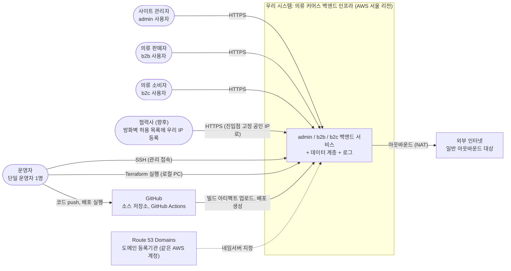
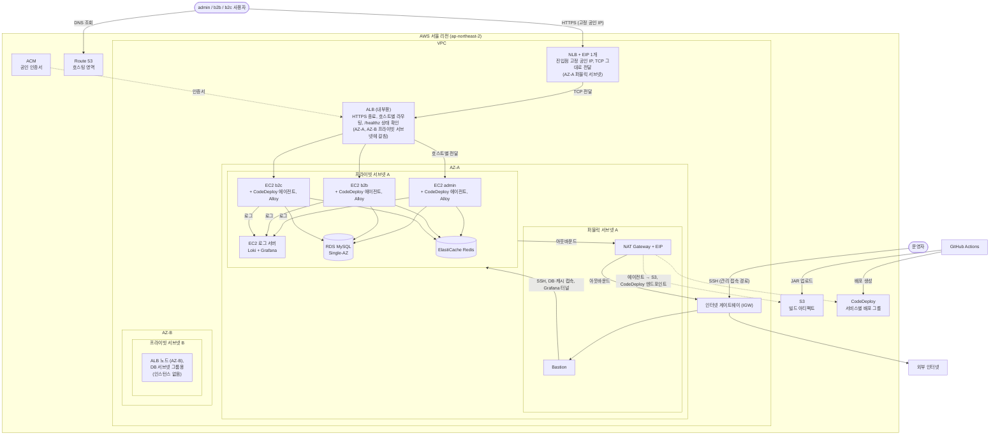
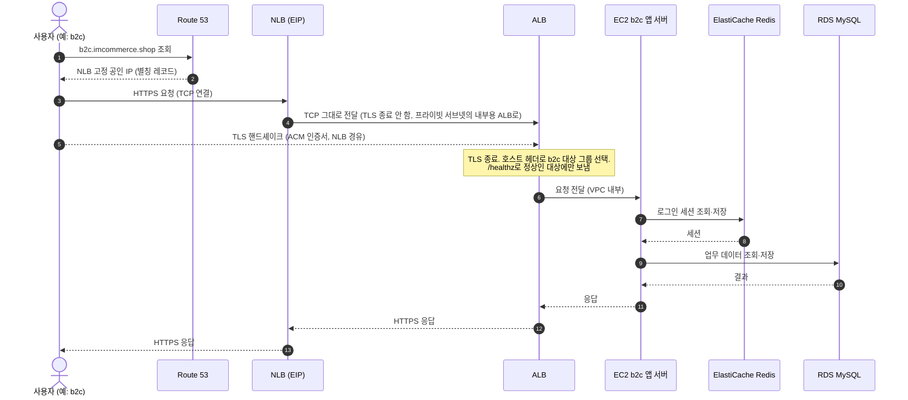
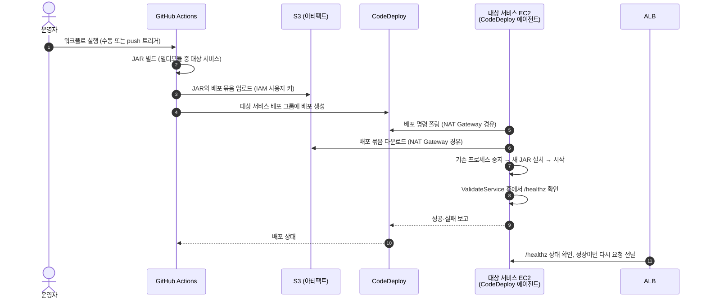

# 03. Architecture — 의류 커머스(admin/b2b/b2c) 백엔드 AWS 인프라

| 항목 | 값 |
|---|---|
| 상태 | Approved |
| 버전 | 1.10 |
| 날짜 | 2026-11-15 |
| 작성자 | 박가온누리 |
| 선행 문서 | [00-context.md](00-context.md) v1.8 (Approved), [01-requirements.md](01-requirements.md) v1.6 (Approved), [02-options.md](02-options.md) v1.4 (Approved), [adr/](adr/) ADR-001~ADR-014 (Accepted. ADR-007·ADR-009·ADR-012는 대체됨) |

### 변경 이력

| 버전 | 변경 내용 | 근거 |
|---|---|---|
| 0.1 | 최초 작성 | 01 v1.2, 02 v1.0, ADR-001~ADR-009 |
| 0.2 | Q-36 반영. 고정 공인 IP를 나가는 쪽(NAT)에서 들어오는 쪽(NLB + EIP)으로 옮김. 1~6절, 8절 갱신 | 00 v1.6, 01 v1.3, 02 v1.1, [ADR-010](adr/ADR-010-inbound-static-ip.md) |
| 1.0 | 승인. 8절 추가 결정 필요 항목은 열린 채로 둠 | 박가온누리 승인 (2026-11-12) |
| 1.1 | ALB를 프라이빗 서브넷의 내부용으로 옮김(ADR-010). 1, 3, 4-1, 5, 6절 갱신. X-08 해결. 승인 | [ADR-010](adr/ADR-010-inbound-static-ip.md), 박가온누리 승인 (2026-11-12) |
| 1.2 | 리뷰 A-01 반영: 인터넷 게이트웨이, 라우팅 테이블, 보안 그룹 추가(ADR-011). 3, 5, 6절 갱신. 선행 문서의 02 버전을 v1.2로 바로잡음(리뷰 A-15). 승인. 리뷰 A-02~A-20은 열린 채로 둠 | [ADR-011](adr/ADR-011-network-boundary.md), [03 리뷰](reviews/03-architecture-review.md), 박가온누리 승인 (2026-11-12) |
| 1.3 | 3절 다이어그램에서 사용자 → NLB 경로를 IGW를 거치지 않게 표기(사용자 지시). IGW는 NAT·Bastion 경로와 5절 표에 남김 | 사용자 지시 (2026-11-12) |
| 1.4 | NLB를 AZ-A 하나에만 두고 EIP 1개로 변경(ADR-010, 04-design N-03). S3 VPC 엔드포인트를 두지 않기로 해 X-02 해결(N-02). 3, 4-4, 5, 6, 8절 갱신. 승인(v1.3 변경 포함) | 결정자 지정, 박가온누리 승인 (2026-11-12) |
| 1.5 | 설계 리뷰 DR-13 반영: AZ-B 서브넷 설명과 다이어그램 노드에서 예전 문구(NLB, 캐시 서브넷 그룹)를 취소선 처리하고 현재 값을 적음. DR-18: 선행 문서 버전 수정, 변경 이력 정렬. DR-21: X-06·X-07은 compute.md C-03·C-04를 따름. DR-22: X-03 해결, 6절 NFR-06을 ○로 바꿈. 01 v1.4 반영: FR-12 삭제에 따라 4-3절 근거, 5절, 6절 충족 표 정리. 승인 | [설계 리뷰 통합](reviews/design-review-summary.md), 결정자 지정 (2026-11-12), 박가온누리 승인 (2026-11-12) |
| 1.6 | ADR-007이 ADR-012로 대체돼(설계 리뷰 DR-15) 근거 참조를 ADR-012로 바꿈. 내용 변경 없음. 승인(참조만 바꾼 변경, 결정자 "진행" 지시) | [ADR-012](adr/ADR-012-subnet-layout.md), 결정자 지시 (2026-11-12) |
| 1.7 | ADR-012 개정 반영: AZ-B 퍼블릭 서브넷(public-b) 삭제. 1절 개요, 3절 다이어그램(퍼블릭 서브넷 B 노드 삭제)과 설명, 5절 구성 요소 표 갱신. 로그 서버는 다이어그램대로 프라이빗 서브넷 A에 있어 바뀌지 않음. 승인 | [ADR-012](adr/ADR-012-subnet-layout.md) (2026-11-15 개정), network.md v1.3, 박가온누리 승인 (2026-11-15) |
| 1.8 | ADR-009가 ADR-013으로, ADR-012가 ADR-014로 대체돼(05 AI-08) 근거 참조를 바꿈. ADR-013 반영: 4-3절 RDS 비밀번호 설명, 5절 구성 요소 표에 Secrets Manager 시크릿 추가, 6절 FR-11 비고, 8절 X-04(Redis 인증 토큰 쓰지 않음). 3절 다이어그램은 바꾸지 않음(Secrets Manager는 RDS가 만드는 부속 리소스) | [ADR-013](adr/ADR-013-secrets-managed-rds.md), [ADR-014](adr/ADR-014-subnet-layout-8.md), 결정자 지정 (2026-11-15) |
| 1.9 | 00 v1.7·01 v1.5 반영(NFR-07·CON-13 변경): 4-2절 다이어그램 표기, 4-3절 4단계, 5절 IAM 사용자 행, 6절 NFR-07 행. Terraform은 루트 계정 `aws login`, GitHub Actions는 IAM 사용자 키. 선행 문서 버전 갱신 | 결정자 지정 (2026-11-15), 00 v1.7, 01 v1.5 |
| 1.10 | 00 v1.8·01 v1.6 반영(Q-37): 1절 구성도와 외부 시스템 표의 도메인 등록기관을 가비아에서 Route 53 Domains로 바꿈 | 00 v1.8, 01 v1.6, 결정자 지정 (2026-11-15) |

> **읽는 법**
> - 이 문서는 ADR에서 정한 구성 요소만 쓴다. ADR에 없는데 필요해 보이는 것은 8절 "추가 결정 필요"에 적었다.
> - CIDR, 포트 번호, 인스턴스 타입 같은 상세 설정값은 쓰지 않는다. 04-design 단계에서 정한다.
> - AZ 이름은 실제 이름 대신 **AZ-A**(인스턴스를 모으는 AZ)와 **AZ-B**(다른 AZ)로 쓴다(ADR-014).

---

## 1. 아키텍처 개요

- 서울 리전의 VPC 하나에 AZ 2개(AZ-A, AZ-B)에 걸쳐 서브넷을 둔다. 퍼블릭 서브넷은 AZ-A에만, 프라이빗 서브넷은 두 AZ에 둔다. 인스턴스와 데이터 계층은 AZ-A 한 곳에 모은다([ADR-014](adr/ADR-014-subnet-layout-8.md)).
- 사용자 요청은 Route 53 → **NLB(EIP, 고정 공인 IP)** → ALB(**프라이빗 서브넷의 내부용**. ACM 인증서로 HTTPS 종료, 호스트별 라우팅, `/healthz` 상태 확인) → 서비스별 EC2 앱 서버 → RDS MySQL·ElastiCache Redis로 흐른다([ADR-010](adr/ADR-010-inbound-static-ip.md), [ADR-003](adr/ADR-003-tls-routing.md), [ADR-001](adr/ADR-001-compute.md), [ADR-008](adr/ADR-008-data-tier.md)). 협력사는 NLB의 EIP를 자기 방화벽 허용 목록에 등록한다. 인터넷에서 접근할 수 있는 곳은 NLB까지다.
- 프라이빗 서버의 아웃바운드는 NAT Gateway로 나간다. 나가는 쪽 IP는 고정일 필요가 없다([ADR-004](adr/ADR-004-outbound-nat.md), Q-36). 운영자는 Bastion SSH 하나로만 서버와 DB에 접근한다([ADR-005](adr/ADR-005-operator-access.md)).
- 앱은 GitHub Actions → S3 → CodeDeploy로 배포하고([ADR-002](adr/ADR-002-deployment.md)), 로그는 Alloy → Loki → Grafana(자체 호스팅)로 모은다([ADR-006](adr/ADR-006-logging.md)). 비밀값은 앱 서버 안의 Secret 파일로 두며, Terraform으로는 넣지 않는다([ADR-013](adr/ADR-013-secrets-managed-rds.md)).
- 고가용성은 보장하지 않는다(00 3.2). AZ-A에 장애가 나면 모든 서비스가 멈춘다(4-4절).

## 2. Context 다이어그램

| 대상 | 종류 | 우리 시스템과의 관계 | 근거 |
|---|---|---|---|
| 사이트 관리자 / 의류 판매자 / 의류 소비자 | 사용자 | 각 서비스 도메인으로 HTTPS 요청 | 00 2.1, Q-22, FR-02, FR-03 |
| 협력사 (향후) | 외부 시스템 | 자기 방화벽의 나가는 쪽 허용 목록에 진입점 고정 공인 IP(NLB의 EIP)를 등록하고 HTTPS로 접속 | 00 2.2, Q-36, FR-06 |
| 운영자 | 사용자 | Bastion SSH로 관리 접속, 로컬 PC에서 Terraform 실행 | FR-07, CON-11, CON-12 |
| ~~가비아~~ Route 53 Domains | 외부 시스템(같은 AWS 계정, Terraform 밖) | `imcommerce.shop`을 등록하고 네임서버를 우리 Route 53 호스팅 영역으로 지정 | CON-10, Q-37 |
| GitHub (Actions) | 외부 시스템 | JAR 빌드, S3 업로드, CodeDeploy 배포 생성 | FR-08, CON-09, ADR-002 |
| 외부 인터넷 | 외부 시스템 | 프라이빗 서버의 일반 아웃바운드 대상 | FR-05, Q-34 |

## 3. Container 다이어그램

- **AZ-B에는 인스턴스가 없다.** AZ-B 서브넷은 ~~NLB(퍼블릭),~~ ALB(프라이빗), ~~DB·캐시 서브넷 그룹(프라이빗)~~ DB 서브넷 그룹(프라이빗)처럼 AZ 2개를 요구하는 리소스를 위해 둔다(ADR-014). NLB는 AZ-A에만 있고(ADR-010), 캐시 서브넷 그룹은 AZ-A 서브넷 하나다(04-design/network.md N-06, N-08). ~~AZ-B 퍼블릭 서브넷은 예비다.~~ AZ-B에는 퍼블릭 서브넷을 두지 않는다(ADR-014 개정, 2026-11-15).
- **인터넷에 노출되는 진입점은 NLB뿐이다.** ALB는 프라이빗 서브넷의 내부용이라 공인 IP가 없고, NLB에서 오는 트래픽만 받는다(ADR-010, ADR-003).
- **인터넷과 오가는 트래픽은 모두 인터넷 게이트웨이를 지난다.** 퍼블릭 서브넷(NLB, NAT Gateway, Bastion)은 IGW로 직접 나가고, 프라이빗 서브넷은 NAT Gateway를 거쳐 IGW로 나간다. 라우팅 테이블은 퍼블릭용과 프라이빗용 두 종류다(ADR-011).
- **보안 그룹으로 계층마다 들어오는 곳을 좁힌다.** ALB는 NLB에서만, 앱 서버는 ALB 보안 그룹에서만, MySQL·Redis는 앱 서버와 Bastion에서만 받는다(ADR-011, ADR-003). 포트와 CIDR 값은 04에서 정한다.
- **고정 공인 IP는 들어오는 쪽에만 있다.** NLB는 AZ-A에만 있고 EIP는 1개다(ADR-010). NAT Gateway에도 EIP가 붙지만 고정 IP 요구 때문은 아니다(ADR-004).
- **로그 서버와 데이터 계층은 프라이빗 서브넷에 둔다.** 인터넷에서 직접 접근할 수 없어야 하기 때문이다(NFR-06). Grafana 화면은 Bastion을 거친 SSH 터널로 연다(ADR-006).
- 앱 서버가 S3와 CodeDeploy로 가는 경로는 NAT Gateway를 거친다. S3는 공인 엔드포인트로 접근하고 VPC 엔드포인트는 두지 않는다(8절 X-02, 결정자 지정 2026-11-12). 버킷은 비공개로 두고 IAM으로 접근을 제어한다.

## 4. 주요 흐름

### 4-1. 사용자 요청 흐름 (DNS부터 DB까지)

- HTTP 요청은 받지 않는다. NLB와 ALB 모두 HTTPS 포트 리스너만 둔다(NFR-06, Q-27). ALB는 프라이빗 서브넷의 내부용이며 NLB에서 오는 트래픽만 받는다(ADR-003, ADR-010).
- 대상 서비스가 `/healthz`에 정상 응답하지 않으면 ALB는 그 서비스로 요청을 보내지 않는다(FR-13). 다른 두 서비스는 영향을 받지 않는다(NFR-05).

### 4-2. 앱 배포 흐름

- 서비스마다 배포 그룹을 따로 두므로, 다른 두 서비스의 JAR는 바뀌지 않는다(NFR-10).
- 배포 중에는 대상 서비스가 잠시 멈출 수 있다. 계획된 다운타임으로 허용한다(NFR-11, 00 3.2).
- 롤백은 이전 리비전을 같은 흐름으로 다시 배포한다(NFR-08).
- 비밀값(Secret 파일)을 서버에 넣는 방법은 아직 정하지 않았다(ADR-013, 8절 X-04). 그래서 이 흐름에 넣지 않았다.

### 4-3. 인프라 변경 흐름

> **요청과 다르게 적었다.** 요청한 흐름은 "PR → plan → 승인 → apply"다. 그러나 00 3.4(Q-P-04)와 01 6.1은 "단일 운영자가 변경하고, Terraform PR 절차는 적용하지 않음"으로 확정했다. Terraform은 Local State로 운영자 PC에서만 실행한다(CON-11, A-04). 아래에는 00·01에서 확정한 흐름을 적었다. PR 절차를 넣으려면 00을 고쳐야 한다(8절 X-01).

| 단계 | 하는 일 | 실행 위치 | 관련 요구사항 |
|---|---|---|---|
| 1 | Terraform 코드를 고친다. 액세스 키가 필요한 위치에는 주석을 남기고, 실행 직전에 값을 넣는다 | 운영자 PC | FR-11 (R-02 결정) |
| 2 | `terraform plan`으로 바뀌는 내용을 확인한다 | 운영자 PC (Local State) | FR-11 |
| 3 | 운영자가 plan 결과를 직접 검토하고 적용할지 정한다 (별도 승인자 없음) | 운영자 | CON-12 |
| 4 | `terraform apply`로 적용한다. ~~공용 IAM 사용자 키를 쓴다~~ 루트 계정 `aws login` 자격 증명을 쓴다(NFR-07, 2026-11-15) | 운영자 PC → AWS API | FR-11, NFR-07 |
| 5 | `terraform plan -detailed-exitcode`로 코드와 실제 상태가 같은지 확인한다 | 운영자 PC | FR-11 |
| 6 | 테스트가 모두 끝나면 `terraform destroy`로 전부 지운다 | 운영자 PC | 00 5.2 종료 처리(Q-04). ~~FR-12~~ 요구사항은 삭제됨 |

- ~~RDS는 임시 비밀번호로 만들고, 구축이 끝난 뒤 운영자가 직접 바꾼다. 바꾼 비밀번호 때문에 5단계 검증이 실패하지 않도록 변경 감지에서 빼야 한다(ADR-009, 05에서 확정).~~ RDS 마스터 비밀번호는 RDS 관리형 비밀번호(Secrets Manager)로 만든다. Terraform이 비밀번호를 다루지 않으므로 바꾼 비밀번호 때문에 5단계 검증이 실패하지 않는다(ADR-013).

### 4-4. 장애 흐름 (AZ 하나에 장애가 났을 때)

| 구성 요소 | AZ-A 장애 | AZ-B 장애 |
|---|---|---|
| Route 53, ACM, S3, CodeDeploy (리전 서비스) | 계속 동작 | 계속 동작 |
| NLB (AZ-A, EIP 1개) | **멈춤.** 진입점이 AZ-A에만 있다 | 계속 동작 |
| ALB | AZ-B 노드는 살아 있지만 정상 대상이 없어 오류를 돌려준다 | AZ-A 노드로 계속 동작 |
| 앱 서버 3대 (admin / b2b / b2c) | **멈춤** | 계속 동작 |
| RDS MySQL (Single-AZ) | **멈춤**. 자동 장애 조치 없음 | 계속 동작 |
| ElastiCache Redis | **멈춤**. 세션 유실 허용(Q-15) | 계속 동작 |
| NAT Gateway | **멈춤**. 아웃바운드와 배포가 끊긴다 | 계속 동작 |
| Bastion | **멈춤**. 관리 접속이 끊긴다 | 계속 동작 |
| 로그 서버 (Loki + Grafana) | **멈춤** | 계속 동작 |
| **결과** | **3개 서비스 모두 응답하지 않는다.** 고가용성을 보장하지 않으므로 받아들인다(00 3.2, ADR-014). 복구는 운영자가 수동으로 한다(CON-12, A-03) | **영향 없음.** NLB, 앱 서버, 데이터 계층이 모두 AZ-A에 있다. ALB의 AZ-B 노드만 빠진다 |

- AZ-A 장애 때 복구 절차(다른 AZ에 다시 만들기 등)는 정하지 않았다. RTO와 RPO를 정의하지 않고 백업도 하지 않으므로(00 3.2), 데이터는 장애가 끝난 뒤 RDS 스토리지가 살아 있을 때만 남는다.

## 5. 구성 요소 표

| 구성 요소 | 역할 | 결정 근거 | 관련 요구사항 |
|---|---|---|---|
| Route 53 호스팅 영역 | `imcommerce.shop` DNS. 서비스 도메인 3개를 NLB로 연결. ACM DNS 검증 | CON-10 (고정 제약) | FR-02, FR-03 |
| ACM 공인 인증서 | 서비스 도메인 3개의 TLS 인증서 | [ADR-003](adr/ADR-003-tls-routing.md) | FR-02 |
| NLB + EIP 1개 (AZ-A) | 진입점 고정 공인 IP. TCP를 ALB로 그대로 전달 | [ADR-010](adr/ADR-010-inbound-static-ip.md) | FR-06, NFR-06, NFR-13, CON-15 |
| ALB (내부용) | HTTPS 종료, 호스트별 라우팅, `/healthz` 상태 확인. NLB 뒤 프라이빗 서브넷에 둠 | [ADR-003](adr/ADR-003-tls-routing.md), [ADR-010](adr/ADR-010-inbound-static-ip.md) | FR-02, FR-03, FR-13, NFR-04, NFR-05, NFR-06 |
| VPC, 서브넷 (~~AZ 2개 × 퍼블릭·프라이빗~~ AZ-A 퍼블릭·프라이빗, AZ-B 프라이빗) | 네트워크 경계. 인스턴스는 AZ-A에 모음 | [ADR-014](adr/ADR-014-subnet-layout-8.md) | NFR-02, NFR-03, NFR-06 |
| 인터넷 게이트웨이 | VPC와 인터넷 사이 출입구. NLB 인바운드, NAT·Bastion 아웃바운드 | [ADR-011](adr/ADR-011-network-boundary.md) | FR-05, FR-06, FR-07 |
| 라우팅 테이블 (퍼블릭용, 프라이빗용) | 퍼블릭 서브넷은 IGW로, 프라이빗 서브넷은 NAT Gateway로 기본 경로 | [ADR-011](adr/ADR-011-network-boundary.md) | FR-05, NFR-06 |
| 보안 그룹 (ALB, 앱 서버, MySQL·Redis) | ALB ← NLB, 앱 서버 ← ALB, MySQL·Redis ← 앱 서버·Bastion만 허용 | [ADR-011](adr/ADR-011-network-boundary.md), [ADR-003](adr/ADR-003-tls-routing.md) | NFR-06, FR-04, NFR-14 |
| EC2 앱 서버 3대 (admin / b2b / b2c) | 서비스별 Spring Boot JAR 실행. 수동 중지·시작 | [ADR-001](adr/ADR-001-compute.md) | FR-03, FR-05, NFR-05, NFR-10, CON-03, CON-14 |
| RDS MySQL (Single-AZ) | 세 서비스가 함께 쓰는 DB. 수동 중지·시작 | [ADR-008](adr/ADR-008-data-tier.md) | FR-04, NFR-14, CON-08 |
| ElastiCache Redis | 로그인 세션 저장. 중지하지 않음 | [ADR-008](adr/ADR-008-data-tier.md) | FR-04, CON-08, NFR-13 |
| NAT Gateway + EIP | 프라이빗 서버의 아웃바운드. 고정 IP 요구는 없음(EIP는 NAT Gateway를 만들 때 함께 붙음) | [ADR-004](adr/ADR-004-outbound-nat.md) | FR-05, NFR-13 |
| Bastion | 운영자의 유일한 관리 접속 경로(SSH). DB·캐시 접속, Grafana 터널 | [ADR-005](adr/ADR-005-operator-access.md) | FR-04, FR-07, NFR-06, NFR-14 |
| EC2 로그 서버 (Loki + Grafana) | 로그 저장과 서비스별 조회 화면 | [ADR-006](adr/ADR-006-logging.md) | FR-09, NFR-09 |
| Grafana Alloy (앱 서버마다) | 앱 로그 수집, 서비스 레이블을 붙여 Loki로 전송 | [ADR-006](adr/ADR-006-logging.md) | FR-09, NFR-09 |
| S3 버킷 (아티팩트) | 서비스별 JAR와 배포 묶음 보관 | CON-09 (고정 제약) | FR-08, NFR-08 |
| CodeDeploy (서비스별 배포 그룹, 앱 서버 에이전트) | 서비스별 배포·재배포, 배포 뒤 상태 확인 | [ADR-002](adr/ADR-002-deployment.md) | FR-08, NFR-08, NFR-10, NFR-11 |
| GitHub Actions | JAR 빌드, S3 업로드, 배포 생성 | CON-09 (고정 제약) | FR-08 |
| IAM 사용자 (~~공용~~ 액세스 키 1개) | ~~Terraform과~~ GitHub Actions의 AWS 자격 증명. Terraform은 루트 계정 `aws login`으로 실행 | CON-13 (고정 제약) | NFR-07, FR-11 |
| Secret 파일 (앱 서버 안) | DB 비밀번호 등 비밀값. 넣는 방법은 미정 | [ADR-013](adr/ADR-013-secrets-managed-rds.md) | FR-04 |
| Secrets Manager 시크릿 (RDS 관리형 비밀번호) | RDS 마스터 비밀번호 보관. RDS가 만들고 지운다. 운영자가 값을 읽어 Secret 파일에 넣는다 | [ADR-013](adr/ADR-013-secrets-managed-rds.md) | FR-04, NFR-13 |
| Terraform (Local State, 운영자 PC) | 인프라 생성·변경·삭제 | CON-11 (고정 제약) | FR-11 |

## 6. 요구사항 충족 표 (01의 Must)

> ○ 충족 / △ 조건부 충족(조건 표기) / × 충족하지 못함

| 요구사항 | 충족 | 충족하는 구성 요소 | 조건·미충족 이유 |
|---|---|---|---|
| FR-02 유효한 인증서로 HTTPS | ○ | ACM, ALB, NLB(전달), Route 53 | |
| FR-03 도메인별 라우팅 | ○ | ALB 호스트 규칙, 앱 서버 3대 | |
| FR-04 MySQL·Redis 공유, 세션 저장 | ○ | RDS, ElastiCache, 앱 서버, Bastion(검증) | |
| FR-05 프라이빗 아웃바운드 | ○ | NAT Gateway | |
| FR-06 진입점 고정 공인 IP | ○ | NLB의 EIP 1개 | ~~NAT Gateway의 EIP~~ (Q-36에서 들어오는 쪽으로 바뀜) |
| FR-07 관리 경로 하나 | ○ | Bastion | |
| FR-08 CI/CD 배포 | △ | GitHub Actions, S3, CodeDeploy | Ubuntu 24.04에서 CodeDeploy 에이전트가 동작하는지 확인하지 않았다(A-06, ADR-002 후속 조치) |
| FR-11 IaC로 생성·변경·삭제 | △ | Terraform | ~~RDS 비밀번호를 바꾼 뒤 `plan` 검증이 실패하지 않게 하는 방법을 05에서 정해야 한다(ADR-009)~~ RDS 관리형 비밀번호를 써서 Terraform이 비밀번호를 다루지 않는다(ADR-013) |
| FR-13 `/healthz` 상태 확인 | ○ | ALB 대상 그룹, 앱 서버 | |
| NFR-02 서울 리전만 | △ | 모든 구성 요소 | Route 53, IAM은 리전이 없는 전역 서비스다. 리전 밖 리소스로 볼지 정하지 않았다 |
| NFR-04 가동 시간에 3개 서비스 응답 | ○ | ALB, 앱 서버 3대 | |
| NFR-06 인터넷에는 HTTPS와 관리 경로만 | ○ | NLB(HTTPS 포트만), ALB(프라이빗 서브넷의 내부용, NLB에서만 받음), Bastion, 프라이빗 서브넷, 보안 그룹(ADR-011) | ~~Bastion SSH는 인터넷에 열린다. 출발지 제한 규칙을 ADR에 정하지 않았다(8절 X-03)~~ Bastion SSH는 운영자 공인 IP `/32` 하나에서만 받는다(04-design/security.md S-04, 설계 리뷰 DR-22) |
| NFR-07 ~~공용 IAM 사용자~~ CI/CD는 IAM 사용자, 루트 보호 | ○ | IAM 사용자 | 루트 MFA와 액세스 키 없음은 계정 설정으로 지킨다(아키텍처 구성 요소 아님). Terraform은 루트 `aws login`(01 v1.5) |
| NFR-11 배포 뒤 응답 | ○ | CodeDeploy `ValidateService`, ALB 상태 확인 | |
| NFR-12 월 100달러 이하 | △ | 전체 | 중지해도 나가는 비용이 하루 약 $3.58이다(NLB EIP 1개, ALB 내부용, 02 13.2절). **리소스가 약 25일 이상 존재하면 넘는다.** 02 비용은 ADR-001·005·006에서 정한 서버 크기로 다시 계산하지 않았다 |
| NFR-13 중지 시 과금 산정 | △ | NLB + EIP 1개, ALB, NAT Gateway + EIP, ElastiCache, RDS 스토리지, EBS, Route 53 | 02 비용표에 위 항목이 있다. RDS는 7일 뒤 자동으로 다시 시작된다(ADR-008). 대비 절차는 05에서 정한다 |
| NFR-14 MySQL 재시작 뒤 데이터 유지 | ○ | RDS 스토리지 | |

## 7. 의도적으로 넣지 않은 것

| 항목 | 이유 |
|---|---|
| 앱 서버 Auto Scaling, Multi-AZ 배치 | 서비스별 1대, Auto Scaling 없음(CON-14). 고가용성 보장 안 함(00 3.2) |
| RDS Multi-AZ, ElastiCache 복제본 | 고가용성 보장 안 함(00 3.2, ADR-008) |
| 백업 | 백업하지 않음(00 3.2, Q-09) |
| 메트릭, 알람, 예산 알림 | 필요 없음(Q-21, Q-33) |
| WAF, Shield Advanced | 범위 제외(Q-S-06) |

## 8. 추가 결정 필요

> ADR에서 정하지 않았지만 이 아키텍처에 영향을 주는 항목이다. 구성 요소는 추가하지 않았다.

| ID | 항목 | 왜 필요한가 | 관련 요구사항 | 결정 시점 |
|---|---|---|---|---|
| X-01 | 인프라 변경에 PR → plan → 승인 → apply 절차를 넣을지 | 요청한 흐름이 00 3.4(Q-P-04: PR 절차 없음)와 맞지 않는다. 넣으려면 00을 고치고 State 공유 방식(현재 Local State)도 다시 봐야 한다 | FR-11, CON-11, CON-12 | 03 승인 전 |
| X-02 | ~~앱 서버에서 S3로 가는 경로 (NAT Gateway 경유 또는 S3 게이트웨이 엔드포인트)~~ **해결(2026-11-12)**: NAT Gateway를 거쳐 S3 공인 엔드포인트로 접근. VPC 엔드포인트 없음. 버킷은 비공개 | 02 D-04에서 엔드포인트를 함께 두라고 제안했지만 ADR-004에는 없다. 엔드포인트가 없으면 아티팩트 다운로드가 NAT 처리 요금을 낸다 | FR-05, FR-08, NFR-12 | 04 전 |
| X-03 | ~~Bastion SSH의 출발지 제한 규칙~~ **해결(2026-11-12)**: 운영자 공인 IP `/32` 하나로 제한(04-design/security.md S-04, DR-22) | ADR-005는 운영자 IP가 고정이라고만 적었다. 출발지를 제한하는 규칙이 없으면 NFR-06을 충족하지 못한다 | NFR-06, FR-07 | 04 전 |
| X-04 | Secret 파일을 앱 서버에 넣는 방법, ~~ElastiCache 인증 토큰 사용 여부~~ (인증 토큰은 쓰지 않음, ADR-013, 2026-11-15) | ADR-013에서 미정이다. 4-2 배포 흐름에 들어갈지가 정해진다 | FR-04, FR-11 | 05 전 |
| X-05 | 로그 서버로의 로그 전송 경로와 Grafana 접근 경로 확정 | ADR-006은 "Grafana 화면은 Bastion SSH 터널로 접근하고, 03에서 경로를 확정한다"고 했다. 이 문서는 그 방식을 그대로 그렸다. 확정해 주면 ADR-006에 반영한다 | FR-09, NFR-06, NFR-09 | 03 승인 전 |
| X-06 | ~~매일 중지·시작하는 대상에 Bastion과 로그 서버를 넣을지~~ **해결(2026-11-12)**: 04-design/compute.md C-03을 따른다(수동 중지, DR-21) | CON-03은 "컴퓨팅, MySQL"을 중지·시작한다고만 적었다. 두 서버도 EC2라 중지하면 비용이 줄지만, 로그 서버를 멈추면 그동안의 로그는 수집되지 않는다 | CON-03, NFR-12, NFR-13 | 05 전 |
| X-07 | ~~시작 순서~~ **해결(2026-11-12)**: 04-design/compute.md C-04를 따른다(순서 없음, 모든 서버 가동 뒤 헬스 체크, DR-21) | RDS, 로그 서버, 앱 서버를 어떤 순서로 시작할지 정하지 않았다. 앱이 DB보다 먼저 시작되면 `/healthz`가 실패할 수 있다 | NFR-04, FR-13 | 05 전 |
| X-08 | ~~ALB를 인터넷 연결형으로 둘지 내부용으로 둘지~~ **해결(2026-11-12)**: 내부용, 프라이빗 서브넷(ADR-010) | NLB 뒤에 두므로 ALB가 인터넷에 직접 노출될 필요가 없다. 내부용이면 ALB 공인 IPv4 요금(하루 약 $0.24, 추정치)이 없어지고 NFR-06 노출 면이 줄어든다 | NFR-06, NFR-12, NFR-13 | 04 전 |
